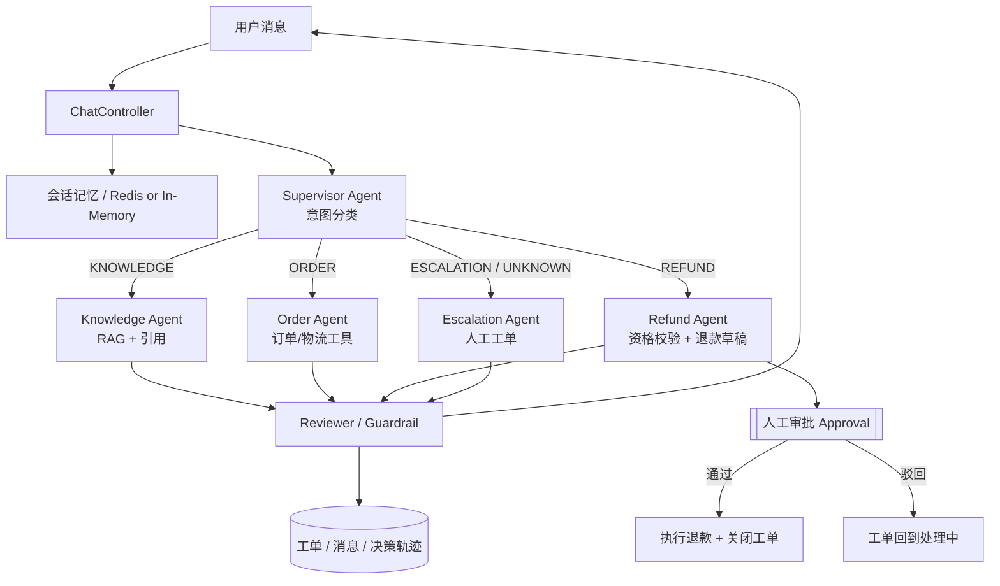

# Nimbus 智能客服 / 工单系统

一个面向生产落地的**多 Agent 智能客服系统**骨架：Spring Boot 3.5 + LangChain4j。覆盖意图路由、RAG 知识库问答（带引用）、真实业务工具调用、敏感操作人工审批（Human-in-the-Loop）、工单持久化、Agent 决策轨迹与固定评估集。

> 当前仓库是**可运行的初始化骨架**：业务规则、编排、审批、持久化、评估、部署链路均已打通；LLM 为可选增强，未配置 API Key 时自动使用确定性路由与模板回复，因此 `mvn test` 和本地启动不依赖任何外部模型或中间件。

## 1. 核心流程



**关键约束**

- 退款、改单、删除数据等敏感操作只生成**审批单**，绝不直接执行。
- 知识类回答必须携带引用；检索不到时明确说明并建议转人工，不编造。
- 每次路由、工具调用、草稿生成、Reviewer 检查都会写入 `agent_traces`，可回放完整决策链路。
- 所有查询按 `customerNo` 做数据隔离。

## 2. 技术栈

| 层级 | 选型 |
|------|------|
| 基础框架 | Spring Boot 3.5.16 / Java 21 |
| AI 编排 | LangChain4j 1.24（OpenAI-compatible ChatModel / EmbeddingModel / PgVector） |
| 数据库 | PostgreSQL（生产）+ Flyway；H2（本地零依赖） |
| 向量库 | PostgreSQL + pgvector（`knowledge_embedding` 表由 PgVectorEmbeddingStore 自动创建） |
| 会话记忆 | Redis（`ChatMemoryStore` 实现）/ 本地内存 |
| 文档 | Springdoc OpenAPI / Swagger UI |
| 部署 | Dockerfile + docker-compose（postgres + redis + app） |

## 3. 项目结构

```text
src/main/java/com/support/agent
├── agent/          # Supervisor、Knowledge/Order/Refund/Escalation、Reviewer、Orchestrator
├── tool/           # 暴露给 LangChain4j 的业务工具（@Tool）
├── service/        # 工单、退款、审批、订单、知识检索、LLM 客户端、评估
├── repository/     # Spring Data JPA
├── controller/     # Chat / Ticket / Approval / Knowledge / Order / Evaluation
├── model/
│   ├── entity/     # 持久化实体
│   ├── dto/        # API 入参/出参
│   └── enums/      # 意图、工单状态、审批状态等
├── evaluation/     # 固定评估集执行器
├── config/         # AI、Redis、OpenAPI、Demo 数据、Prompt 加载
└── common/         # 统一响应、异常、TraceId、订单号解析

src/main/resources
├── application.yml / application-local.yml / application-docker.yml
├── db/migration/   # Flyway V1 初始化脚本
├── knowledge/      # FAQ、退款、配送、保修知识文档
├── prompts/        # Supervisor / Knowledge / Order / Refund / Reviewer 提示词
└── evaluation/     # 25 条固定评估用例

src/test/java         # 路由单测、退款审批集成测试、评估回归测试
docs/                 # 架构说明、决策轨迹示例
```

## 4. 快速开始

### 4.1 本地零依赖启动（H2 + 内存记忆）

要求：**JDK 21+**（编译目标为 21）、Maven 3.9+。

```bash
mvn spring-boot:run
```

- API：<http://localhost:8080>
- Swagger：<http://localhost:8080/swagger-ui.html>
- H2 Console：<http://localhost:8080/h2-console>
  - JDBC URL：`jdbc:h2:mem:customer_support`
  - 用户名：`sa`，密码留空

首次启动会自动建表并写入演示数据（客户 `CUST-001` 与 5 个订单）。

### 4.2 Docker 一键启动（PostgreSQL + pgvector + Redis）

```bash
cp .env.example .env      # 可选：填入 AI_API_KEY
docker compose up --build
```

- 应用：<http://localhost:8080>
- PostgreSQL：`localhost:5432`，库 `customer_support`
- Redis：`localhost:6379`

> 若本机未安装 Docker，可直接使用 4.1 的 H2 模式，功能完全一致。

### 4.3 接入大模型（可选）

默认 `AI_ENABLED=false`，系统使用规则路由 + 模板回答。开启后 Supervisor 使用 LLM 分类，Knowledge/Order Agent 使用 LLM 润色回答；退款链路仍保持确定性护栏。

DeepSeek 示例：

```bash
export AI_ENABLED=true
export AI_BASE_URL=https://api.deepseek.com/v1
export AI_API_KEY=sk-xxx
export AI_CHAT_MODEL=deepseek-chat
export AI_EMBEDDING_MODEL=text-embedding-3-small
```

OpenAI 兼容端点均可，只需修改 `AI_BASE_URL`。使用 Ollama 时可指向 `http://localhost:11434/v1`。如果聊天模型提供商（如 DeepSeek）没有 Embedding API，可单独设置 `AI_EMBEDDING_BASE_URL` 与 `AI_EMBEDDING_API_KEY`。

启用向量检索（PostgreSQL + pgvector）：

```bash
export RAG_VECTOR_STORE=pgvector
# 启动后执行一次索引
curl -X POST http://localhost:8080/api/v1/knowledge/reindex
```

## 5. API 示例

### 5.1 多轮对话

```bash
curl -s -X POST http://localhost:8080/api/v1/chat \
  -H 'Content-Type: application/json' \
  -d '{
    "customerNo": "CUST-001",
    "message": "我的订单 ORD-2026001 到哪了？"
  }'
```

返回包含 `conversationId`、`ticketNo`、`intent`、`answer`、`citations`、`toolsUsed` 与 `trace`。后续对话带上 `conversationId` 即可延续记忆。

### 5.2 退款（触发人工审批）

```bash
curl -s -X POST http://localhost:8080/api/v1/chat \
  -H 'Content-Type: application/json' \
  -d '{"customerNo":"CUST-001","message":"我要退款，订单 ORD-2026001"}'
```

响应中 `requiresApproval=true`，并返回 `approvalNo`。审批列表与决策：

```bash
curl -s 'http://localhost:8080/api/v1/approvals?status=PENDING'

curl -s -X POST http://localhost:8080/api/v1/approvals/{approvalNo}/decision \
  -H 'Content-Type: application/json' \
  -d '{"approved":true,"decidedBy":"admin","comment":"符合 7 天无理由退货"}'
```

审批通过后：退款单变为 `APPROVED`、订单变为 `REFUNDING`、工单变为 `RESOLVED` 并写入系统消息。

### 5.3 工单与轨迹

```bash
curl -s 'http://localhost:8080/api/v1/tickets?status=WAITING_APPROVAL'
curl -s http://localhost:8080/api/v1/tickets/{ticketNo}
curl -s http://localhost:8080/api/v1/tickets/{ticketNo}/traces
curl -s http://localhost:8080/api/v1/tickets/stats
```

### 5.4 知识库检索

```bash
curl -s -X POST http://localhost:8080/api/v1/knowledge/search \
  -H 'Content-Type: application/json' \
  -d '{"query":"退款多久到账？","topK":3}'
```

### 5.5 评估

```bash
curl -s -X POST http://localhost:8080/api/v1/evaluation/run
```

返回意图准确率、工具调用率、审批护栏通过率、整体通过率与逐条明细。

> 评估在单个事务内执行，结束后整体回滚，因此可重复运行且不会污染演示数据（订单状态会在评估事务内临时重置）。

## 6. 数据模型

| 表 | 说明 |
|----|------|
| `customers` | 客户主数据（`customer_no` 为业务主键） |
| `orders` | 演示订单、物流、金额、签收时间 |
| `conversations` | 会话元数据（标题、最后消息时间） |
| `tickets` | 工单（PENDING / IN_PROGRESS / WAITING_APPROVAL / RESOLVED / ESCALATED / CLOSED） |
| `ticket_messages` | 用户、Agent、人工、系统消息，含引用 JSON |
| `agent_traces` | 每一步 Agent 决策、工具调用、耗时 |
| `approval_requests` | 敏感操作审批单 |
| `refund_requests` | 退款草稿与执行状态 |
| `knowledge_embedding` | pgvector 表，由应用启动时自动创建 |

工单状态流转：

```text
PENDING -> IN_PROGRESS -> RESOLVED / CLOSED
                 |-> WAITING_APPROVAL -> RESOLVED / IN_PROGRESS
                 |-> ESCALATED -> RESOLVED / CLOSED
```

## 7. 测试与评估

```bash
mvn test
```

包含：

1. `RuleBasedRouterTest`：路由规则单测（退款、订单、知识、升级）。
2. `RefundApprovalFlowTest`：对话 → 退款草稿 → 审批通过 → 退款/订单/工单状态联动。
3. `EvaluationAcceptanceTest`：25 条固定用例回归，断言意图准确率 ≥ 90%、审批护栏 100% 通过。

## 8. 生产化待办（骨架已留扩展点）

- 接入 Spring Security / OAuth2，补齐租户与角色权限（当前按 `customerNo` 做数据隔离，但未做认证）。
- 审批执行接入真实支付/退款网关，增加幂等键与事务消息/Outbox。
- 工单分配、SLA、通知、人工接管后台（P1）。
- 流式输出（SSE）与前端聊天界面（P1）。
- Token/成本统计、Micrometer 指标与链路追踪（P1）。
- 向量索引增量更新与文档版本管理。
- 评估集扩充到真实线上分布，并加入 LLM-as-judge 与人工抽检。

## 9. 设计说明

- **为什么默认关闭 AI**：保证 CI、演示、评估可重复，避免模型波动导致测试不稳定；配置 Key 后自动切换为 LLM 增强模式。
- **为什么退款不交给 LLM 执行**：退款是不可逆的资金操作，采用“Agent 生成草稿 + 人工审批 + 服务端执行”的硬约束，而不是依赖 Prompt 约束模型。
- **为什么引用存文本 JSON**：H2 与 PostgreSQL 都能运行，避免骨架阶段引入 `jsonb` 方言差异。
- **为什么长时间记忆双写**：Redis 提供短窗口上下文，`ticket_messages` 提供可审计的长期记录。

更多设计细节见 [docs/architecture.md](docs/architecture.md)，决策轨迹示例见 [docs/decision-log-example.md](docs/decision-log-example.md)。
