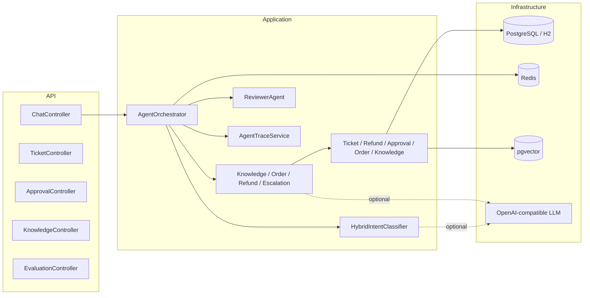
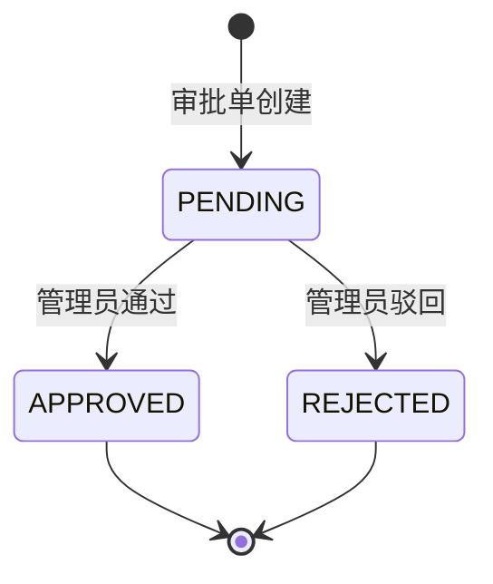

# 架构说明

## 1. 分层

## 2. 一次对话的处理顺序

1. `ConversationService` 获取/创建会话，校验会话归属。
2. `ConversationMemoryService` 写入用户消息并读取最近上下文。
3. `HybridIntentClassifier` 路由：
   - 有 LLM：使用 `supervisor.md` 提示词输出 JSON；解析失败自动回退规则。
   - 无 LLM：`RuleBasedRouter` 基于关键词与订单号打分。
4. `TicketService` 找到会话下活跃工单，或创建新工单。
5. 持久化用户消息。
6. 按意图分发到专家 Agent：
   - `KnowledgeAgent`：向量检索或本地关键词检索，生成带引用的回答。
   - `OrderAgent`：解析订单号，调用订单/物流服务。
   - `RefundAgent`：校验资格，创建退款草稿和审批单。
   - `EscalationAgent`：标记工单升级到人工队列。
7. `ReviewerAgent` 做确定性护栏检查（敏感操作、退款措辞、引用缺失）。
8. 持久化 Agent 回复、更新工单状态、写入会话记忆。
9. 返回 `ChatResponse`，包含完整 `trace`。

每个步骤都会写入 `agent_traces`：`step_no`、`agent`、`action`、输入/输出摘要、`decision`、耗时。

## 3. 人工审批状态机

退款审批通过后的副作用（同一事务）：

1. `refund_requests.status = APPROVED`
2. `orders.status = REFUNDING`
3. `tickets.status = RESOLVED`，写入 `resolution` 与系统消息

驳回则退款单变为 `REJECTED`，工单回到 `IN_PROGRESS`。

## 4. 记忆与持久化

| 数据 | 存储 | 生命周期 |
|------|------|----------|
| 多轮上下文 | Redis / 内存 `ChatMemoryStore` | 24h 滑动窗口，默认 20 条 |
| 完整对话 | `ticket_messages` | 永久（工单归档） |
| 工单状态 | `tickets` | 永久 |
| Agent 决策 | `agent_traces` | 永久 |
| 知识原文 | classpath `knowledge/*.md` | 随版本发布 |
| 知识向量 | pgvector `knowledge_embedding` | 手动重建，可持久化 |

## 5. 失败与降级

- **无 API Key**：规则路由 + 模板回答，功能与审批链路不受影响。
- **LLM 超时/异常**：`LlmClient` 捕获后返回空，Agent 使用模板答案。
- **Redis 不可用**：记忆读写降级为空/忽略，工单消息仍完整落库。
- **向量检索失败**：自动回退到关键词检索。
- **知识库无命中**：明确告知无资料并提示转人工，不编造。

## 6. 安全边界

- 所有订单查询校验 `customerNo`，越权查询统一返回“订单不存在”。
- 退款只能生成草稿，审批通过后由服务端执行。
- Reviewer 拦截“已退款 / 退款成功”等未授权表述。
- 日志通过 `traceId` 串联，但不会记录 API Key 或完整模型请求（可通过 `app.ai.log-requests` 临时开启）。

## 7. 后续演进

- 将 `AgentOrchestrator` 的 `switch` 分发替换为 LangChain4j `SupervisorAgent` / `sequence` 编排。
- 审批执行改为事件驱动（Outbox + MQ），支持重试与幂等。
- Tool 层接入真实订单/支付服务，并通过 AiServices 自动生成工具调用。
- 增加 SSE 流式输出与前端工作台。
